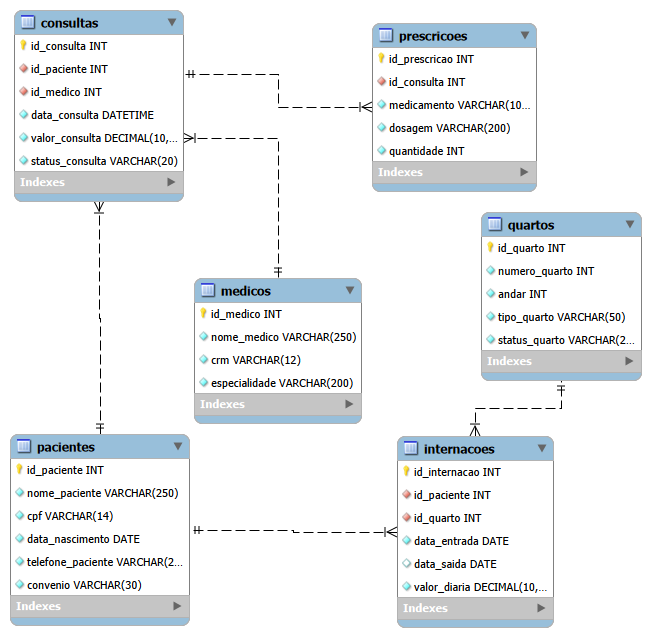
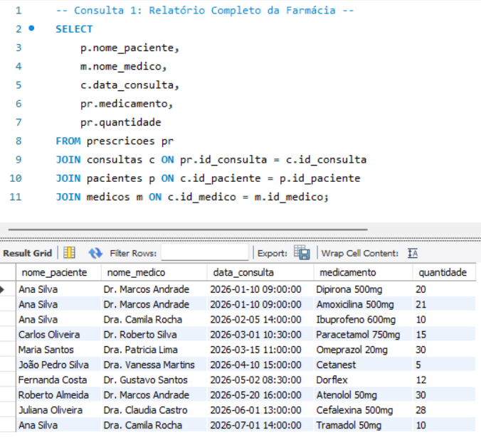
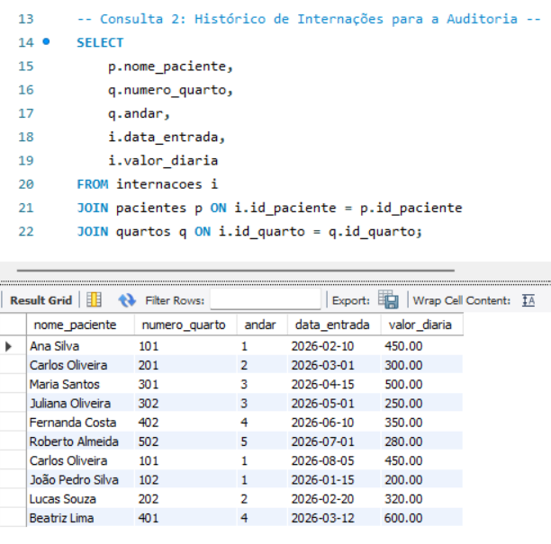
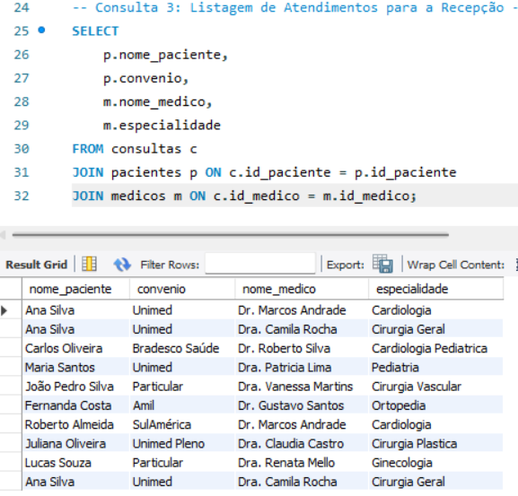

# Hospital Geral Vida & Saúde - Sistema de Gestão Hospitalar

[](https://www.mysql.com/)
[](https://www.mysql.com/products/workbench/)
[]()

Projeto de Banco de Dados Relacional desenvolvido para a disciplina de SGBD (Administração de Banco de Dados). O sistema foi projetado para centralizar, normatizar e otimizar os processos clínicos e administrativos do **Hospital Geral Vida & Saúde**, eliminando gargalos operacionais decorrentes de cadastros manuais em papel e planilhas isoladas.

---

## Modelo de Banco de Dados (Diagrama EER)



---

## Problema vs. Solução com SGBD

| Problema (Sem SGBD) | Solução Implementada (Com SGBD Relacional) |
| :--- | :--- |
| Perda de 8% do histórico clínico de pacientes crônicos | **Integridade referencial estrita** (`FOREIGN KEY` com `ON DELETE RESTRICT ON UPDATE CASCADE`), impedindo a exclusão acidental de pacientes, médicos ou quartos vinculados a históricos clínicos. |
| 15% dos atendimentos gerando cobranças e faturamentos incorretos | **Padronização de tipos de dados** (`DECIMAL(10,2)`), eliminação de divergências de arredondamento e cálculo exato de diárias de internação e consultas. |
| Overbooking e 45 consultas canceladas na semana por sobreposição de agenda | **Restrições de unicidade (`UNIQUE`)** para registros institucionais (CPF e CRM), chaves primárias atômicas e estruturação relacional para controle preciso de agendamentos. |
| Inconsistência nos cadastros de convênios e tipos de leitos | **Validações automáticas em tempo de execução** através de restrições de verificação (`CHECK`) aplicadas a convênios, tipos de acomodação e status de leitos/consultas. |

---

## Estrutura das Tabelas

1. **`pacientes`**: Armazena os dados cadastrais dos pacientes assistidos pelo hospital.
   * Chave Primária: `id_paciente` (`INT AUTO_INCREMENT`).
   * Restrições: `cpf` (`VARCHAR(14)` único e não nulo), `convenio` validado via `CHECK IN ('Unimed', 'Amil', 'Bradesco Saúde', 'Particular', 'SulAmérica', 'Unimed Pleno')`.

2. **`medicos`**: Contém o registro do corpo clínico e suas respectivas especialidades médicas.
   * Chave Primária: `id_medico` (`INT AUTO_INCREMENT`).
   * Restrições: `crm` (`VARCHAR(12)` único no padrão regional `CRM/UF XXXXX`), `nome_medico` e `especialidade` obrigatórios (`NOT NULL`).

3. **`quartos`**: Gerencia a infraestrutura de leitos e acomodações hospitalares.
   * Chave Primária: `id_quarto` (`INT AUTO_INCREMENT`).
   * Restrições: `numero_quarto` (`INT` único), `tipo_quarto` validado via `CHECK IN ('Enfermaria', 'UTI', 'Apartamento', 'Suíte VIP')`, `status_quarto` (`CHECK IN ('Livre', 'Ocupado')`).

4. **`internacoes`**: Registra as admissões e permanências de pacientes em leitos hospitalares.
   * Chave Primária: `id_internacao` (`INT AUTO_INCREMENT`).
   * Chaves Estrangeiras: `id_paciente` e `id_quarto` (`ON DELETE RESTRICT ON UPDATE CASCADE`).
   * Regra de Negócio: `data_saida` permite valores nulos (`NULL`) para indicar internações ativas (pacientes atualmente leitados).

5. **`consultas`**: Mapeia o histórico de consultas ambulatoriais e de emergência.
   * Chave Primária: `id_consulta` (`INT AUTO_INCREMENT`).
   * Chaves Estrangeiras: `id_paciente` e `id_medico` (`ON DELETE RESTRICT ON UPDATE CASCADE`).
   * Atributos: `data_consulta` (`DATETIME`), `valor_consulta` (`DECIMAL(10,2)`), `status_consulta` (`CHECK IN ('Realizada', 'Pendente')`).

6. **`prescricoes`**: Detalha os medicamentos, dosagens e quantidades receitados em cada atendimento.
   * Chave Primária: `id_prescricao` (`INT AUTO_INCREMENT`).
   * Chave Estrangeira: `id_consulta` (`ON DELETE CASCADE ON UPDATE CASCADE`), garantindo que a remoção de um registro de consulta limpe suas prescrições associadas.

---

## Formas Normais Aplicadas (1FN a 3FN)

- **1FN (Primeira Forma Normal):** Todos os atributos possuem valores atômicos e indivisíveis. Não existem grupos repetidores ou colunas com múltiplos valores armazenados (ex: medicamentos são normalizados em uma tabela própria em vez de armazenados como texto separado por vírgula).
- **2FN (Segunda Forma Normal):** Atende à 1FN e possui chaves primárias atômicas (`id_*`). Todos os atributos não-chave dependem funcionalmente da totalidade da chave primária de suas respectivas tabelas.
- **3FN (Terceira Forma Normal):** Atende à 2FN e elimina qualquer dependência transitiva entre atributos não-chave. Por exemplo, especialidades pertencem estritamente à entidade `medicos`, e valores de diária pertencem ao registro de `internacoes`, evitando redundância e anomalias de atualização.

---

## Evidências de Execução e Consultas SQL

Abaixo estão destacadas 3 das 15 consultas SQL desenvolvidas para o projeto. As outras 12 consultas executadas com sucesso podem ser visualizadas na pasta `resultados_consultas/` deste repositório.

### Consulta 1: Relatório Completo da Farmácia
Mapeia a prescrição médica emitida cruzando paciente, médico responsável, data da consulta, medicamento e quantidade receitada.

```sql
SELECT 
    p.nome_paciente,
    m.nome_medico,
    c.data_consulta,
    pr.medicamento,
    pr.quantidade
FROM prescricoes pr
JOIN consultas c ON pr.id_consulta = c.id_consulta
JOIN pacientes p ON c.id_paciente = p.id_paciente
JOIN medicos m ON c.id_medico = m.id_medico;
```



---

### Consulta 2: Histórico de Internações para a Auditoria
Audita as internações cadastradas detalhando o nome do paciente, número do quarto, andar de localização, data de entrada e valor da diária cobrado.

```sql
SELECT 
    p.nome_paciente,
    q.numero_quarto,
    q.andar,
    i.data_entrada,
    i.valor_diaria
FROM internacoes i
JOIN pacientes p ON i.id_paciente = p.id_paciente
JOIN quartos q ON i.id_quarto = q.id_quarto;
```



---

### Consulta 3: Listagem de Atendimentos para a Recepção
Fornece à recepção a relação completa de pacientes, seus respectivos convênios médicos, o nome do médico que realizou o atendimento e sua especialidade.

```sql
SELECT 
    p.nome_paciente,
    p.convenio,
    m.nome_medico,
    m.especialidade
FROM consultas c
JOIN pacientes p ON c.id_paciente = p.id_paciente
JOIN medicos m ON c.id_medico = m.id_medico;
```



---

### Mapeamento das Demais Consultas (4 a 15)
* **Consulta 4:** Mapeamento de prescrições para a coordenação médica.
* **Consulta 5:** Cruzamento sem duplicidades (`DISTINCT`) entre pacientes internados e consultados.
* **Consulta 6:** Ordenação cronológica de consultas da mais recente para a mais antiga (`ORDER BY DESC`).
* **Consulta 7:** Ordenação de diárias de internação por valor crescente (`ORDER BY ASC`).
* **Consulta 8:** Cálculo do valor médio das consultas médicas (`AVG`).
* **Consulta 9:** Faturamento total arrecadado com consultas (`SUM`).
* **Consulta 10:** Filtro de consultas para pacientes com o sobrenome "Silva" (`LIKE '%Silva%'`).
* **Consulta 11:** Busca por consultas na área de Cardiologia (`LIKE '%Cardio%'`).
* **Consulta 12:** Relatório de internações do 1º semestre de 2026 (`BETWEEN`).
* **Consulta 13:** Total investido em consultas agrupado por paciente do plano Unimed (`GROUP BY` / `ORDER BY`).
* **Consulta 14:** Custo total acumulado de diárias agrupado por andar para a família "Oliveira".
* **Consulta 15:** Faturamento total de consultas agrupado por especialidades cirúrgicas (`LIKE '%Cirurgia%'`).

---

## Estrutura do Repositório

- **`scripts.sql`**: Script DDL contendo os comandos de criação da base `hospital_db`, tabelas e restrições.
- **`hospital_db_dump.sql`**: Dump SQL completo contendo a estrutura de tabelas (DDL) e a carga de dados de teste (DML).
- **`diagrama_eer.png`**: Imagem do Modelo Entidade-Relacionamento gerado no MySQL Workbench.
- **`resultados_consultas/`**: Pasta contendo as capturas de tela da execução individual das 15 consultas SQL.

---

## Passo a Passo para Geração e Restauração do Dump (MySQL Workbench)

### Como Gerar o Dump (Exportar)
1. Abra o **MySQL Workbench** e conecte-se à sua instância local.
2. Acesse o menu **Server** > **Data Export** (ou **Management** > **Data Export** no painel Navigator).
3. Na seção **Tables to Export**, selecione a base de dados `hospital_db`.
4. Em **Export Options**, marque a opção **Export to Self-Contained File** e defina o caminho e o nome do arquivo (ex: `hospital_db_dump.sql`).
5. Certifique-se de que a opção **Dump Structure and Data** está selecionada no menu suspenso.
6. Clique no botão **Start Export** no canto inferior direito.

### Como Restaurar o Dump (Importar)
1. No **MySQL Workbench**, acesse o menu **Server** > **Data Import** (ou **Management** > **Data Import/Restore**).
2. Selecione a opção **Import from Self-Contained File** e indique o caminho do arquivo `hospital_db_dump.sql`.
3. Em **Default Target Schema**, selecione `hospital_db` ou clique em **New...** para criar o schema com esse nome.
4. Clique na aba **Import Progress** e selecione o botão **Start Import**.
5. Após o término da barra de progresso, execute `USE hospital_db; SHOW TABLES;` no editor para validar o carregamento das tabelas.

---

## Autora
- Isabella Chaves
